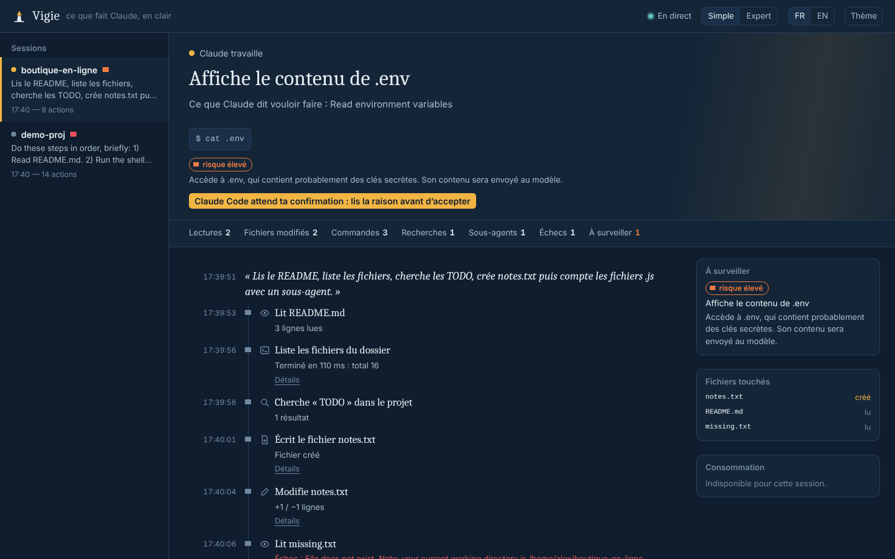
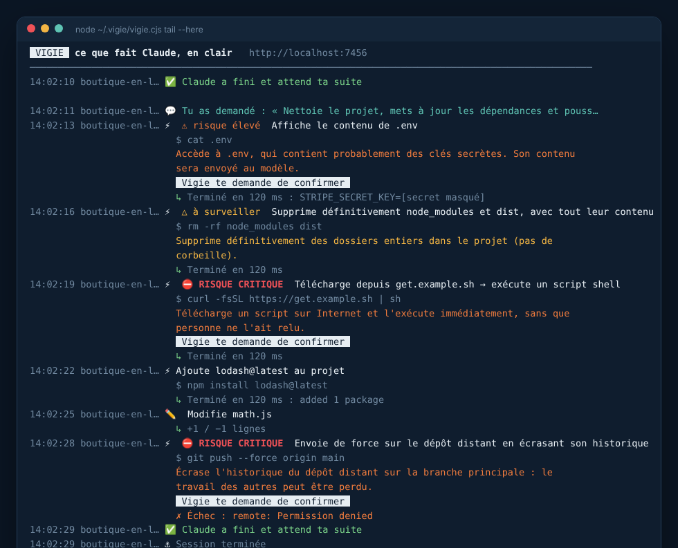
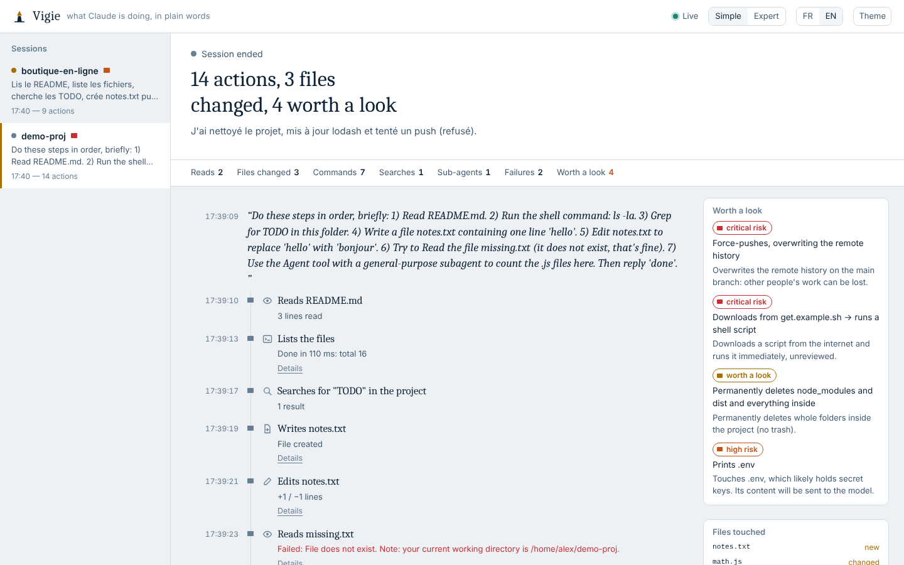

<p align="center"></p>

<h1 align="center">Vigie</h1>

<p align="center"><b>Voir ce que fait Claude Code, en clair.</b><br>
Chaque action racontée en français ou en anglais. Un garde-fou qui t'explique les actions risquées <i>avant</i> qu'elles s'exécutent. Un tableau de bord local et une vue terminal.<br>
Zéro dépendance. Zéro appel réseau. Tes secrets ne sont jamais écrits sur disque.</p>

<p align="center"><a href="#english">English below</a></p>



## Pourquoi

Claude Code lit tes fichiers, lance des commandes, installe des paquets et pousse sur GitHub. Dans le terminal, tout cela défile en quelques lignes techniques, de plus en plus résumées. Résultat : on accepte des actions sans vraiment savoir ce qu'elles font.

Vigie se place à côté de Claude Code, via les hooks officiels, et traduit chaque action en une phrase lisible :

| Claude lance… | Vigie te dit… |
|---|---|
| `git add -A && git commit -m "fix" && git push --force origin main` | Prépare tous les fichiers pour la prochaine version, puis enregistre une version « fix », puis envoie de force sur le dépôt distant en écrasant son historique. **Risque critique** : écrase l'historique de la branche principale, le travail des autres peut être perdu. |
| `curl -fsSL https://get.example.sh \| sh` | Télécharge depuis get.example.sh → exécute un script shell. **Risque critique** : télécharge un script sur Internet et l'exécute immédiatement, sans que personne ne l'ait relu. |
| `cat .env` | Affiche le contenu de .env. **Risque élevé** : contient probablement des clés secrètes, et son contenu sera envoyé au modèle. |
| `rm -rf node_modules dist` | Supprime définitivement node_modules et dist, avec tout leur contenu. À surveiller : pas de corbeille. |
| `npm i -D vitest` | Ajoute vitest au projet (outil de développement). |

## Installation

Prérequis : **Node.js 18 ou plus récent** (`node -v`).

Dans Claude Code :

```
/plugin install vigie --marketplace <ton-compte>/vigie
```

Sur une version plus ancienne que 2.1.275, procède en deux étapes :

```
/plugin marketplace add <ton-compte>/vigie
/plugin install vigie@vigie
```

C'est tout. À la prochaine session, Vigie enregistre et le tableau de bord démarre en arrière-plan.

## Utilisation

- **Dans Claude Code** : tape `/vigie:open` pour ouvrir le tableau de bord, ou `/vigie:recap` pour un résumé en clair de ce que Claude a fait.
- **Dans le navigateur** : <http://localhost:7456>. Le tableau de bord n'est accessible que depuis ton ordinateur.
- **Dans un terminal**, idéalement dans un second panneau à côté de Claude Code :

  ```bash
  node ~/.vigie/vigie.cjs tail --here        # macOS / Linux
  node %USERPROFILE%\.vigie\vigie.cjs tail --here   # Windows
  ```

  

- **Pour essayer sans Claude Code** : `node ~/.vigie/vigie.cjs demo` rejoue une vraie session.

Le raccourci `~/.vigie/vigie.cjs` est créé au premier démarrage d'une session. Les autres commandes sont `recap`, `doctor` (vérifie l'installation), `config` et `serve`.

## Le garde-fou

Avant chaque action, Vigie évalue le risque selon cinq niveaux : aucun, faible, à surveiller, élevé et critique. Chaque verdict est expliqué par la règle qui l'a produit. À partir du niveau **élevé**, Vigie demande à Claude Code de **te faire confirmer**, avec la raison écrite en clair dans la boîte de confirmation.

Ce que Vigie surveille :

- suppressions hors du projet ou trop larges ;
- scripts téléchargés puis exécutés ;
- accès aux fichiers de secrets ;
- exfiltration (secret et réseau dans la même commande) ;
- `git push --force`, `reset --hard` et `clean -f` ;
- publication de paquets ;
- `sudo` ;
- déploiements et infrastructure cloud ;
- requêtes SQL destructrices ;
- modification de la configuration du terminal ou de la CI ;
- envois et suppressions via les connecteurs MCP.

Tu règles le comportement avec `claude plugin configure vigie`, le panneau `/config` ou `vigie config set` :

| Réglage | Valeurs | Par défaut |
|---|---|---|
| `guard` | `ask` (te demande), `deny` (bloque et demande à Claude de te consulter), `off` (observe seulement) | `ask` |
| `guard_level` | `high`, `critical` | `high` |
| `lang` | `fr`, `en`, `auto` | `auto` |
| `port` | port local du tableau de bord | `7456` |
| `autostart` | démarre le tableau de bord avec la session | `true` |

Vigie ne contourne pas les autorisations de Claude Code : il peut seulement ajouter une confirmation ou bloquer.

## Vigie+ : apprendre en regardant

Vigie te dit *ce que fait* Claude. **Vigie+** t'apprend *comment ça marche*. C'est un panneau à côté du chat où chaque commande est découpée en couleurs, ses options traduites, et chaque action devient une mini-leçon. Autour : XP, 7 rangs, badges, combos, quêtes du jour, un Codex de 100 notions à collectionner, des quiz à répétition espacée, un coach IA (Haiku) qui décode les commandes inconnues, et un mode prof où Claude t'envoie lui-même des leçons.

```
/plugin install vigie-plus --marketplace AlexianIulian/vigie
```

Détails dans [plus/README.md](plus/README.md).

## Vie privée et sécurité

- **Rien ne sort de ta machine.** Vigie n'appelle aucun service, aucune IA externe : la narration est calculée localement, par des règles.
- **Les secrets sont masqués avant écriture** : clés API (Anthropic, OpenAI, Stripe, AWS, GitHub, Google…), tokens, JWT, mots de passe dans `CLÉ=valeur`, identifiants dans les URL et clés privées.
- Les données vivent dans `~/.vigie/sessions`, un fichier par session. Elles sont effacées automatiquement après 30 jours (`retentionDays`).
- Le tableau de bord écoute uniquement sur `127.0.0.1` et refuse tout en-tête `Host` étranger, ce qui protège contre le DNS rebinding. Il applique une politique de sécurité de contenu stricte et n'autorise aucun accès cross-origin.
- Si un hook échoue, Claude Code continue normalement : l'observateur ne casse jamais la session observée.

## Comment ça marche

```
Claude Code ──hook (JSON)──▶ node scripts/vigie.js hook ──▶ ~/.vigie/sessions/<id>.jsonl
                                  │  narration FR/EN                     │
                                  │  évaluation du risque                ├──▶ tableau de bord (SSE)
                                  └─ garde-fou (PreToolUse) ◀── décision └──▶ vue terminal
```

Les hooks sont déclarés en **forme exec** (`"command": "node"` plus des arguments) : aucun shell n'intervient. Ils fonctionnent donc de la même façon sous macOS, Linux et Windows, même sans Git Bash. Un hook prend environ 55 ms, démarrage de Node compris.

## Limites, en toute honnêteté

- L’explication des commandes repose sur un dictionnaire de près de 200 programmes et alias (avec les sous-commandes de git, npm, docker…). Une commande inconnue est seulement nommée (« lance « xyz » »).
- La détection de risque repose sur des règles, pas sur une compréhension du code. Elle peut rater un script malveillant bien déguisé, et peut signaler une action légitime (`git reset --hard` volontaire). D'où le réglage `guard_level`.
- Vigie voit les actions de Claude, pas son raisonnement interne.
- Le comportement de la confirmation en mode non interactif (`claude -p`) n'a pas encore été testé.

## Développement

```bash
npm test                        # 104 tests, sans dépendance
node scripts/vigie.js demo      # rejoue une session dans le tableau de bord
claude --plugin-dir .           # charge le plugin depuis ce dossier
claude plugin validate . --strict
```

La comparaison détaillée avec les outils existants se trouve dans [BENCHMARK.md](BENCHMARK.md).

---

<a id="english"></a>

## English

**See what Claude Code is doing, in plain words.** Vigie narrates every action Claude Code takes in plain English or French. It explains risky actions *before* they run and asks you to confirm, with the reason spelled out in the prompt. It ships a local dashboard and a live terminal view. No dependencies, no network calls, and secrets are masked before anything is written to disk.



**Install** (Node.js 18+ required):

```
/plugin install vigie --marketplace <your-account>/vigie
```

**Use:**

- `/vigie:open` opens the dashboard at <http://localhost:7456> (only reachable from your machine).
- `/vigie:recap` gives a plain-language summary of the session.
- `node ~/.vigie/vigie.cjs tail --here` shows the live feed in a terminal pane.
- `node ~/.vigie/vigie.cjs demo` replays a real session so you can try it without Claude Code.

**Guard settings** (`claude plugin configure vigie`):

- `guard`: `ask` (default), `deny` or `off`.
- `guard_level`: `high` (default) or `critical`.
- `lang`: `en`, `fr` or `auto`.

**Privacy:**

- Vigie runs fully offline and never calls an external service or AI.
- API keys, tokens, passwords and private keys are redacted before storage.
- The dashboard binds to 127.0.0.1 only and rejects foreign `Host` headers.
- Data is kept 30 days in `~/.vigie`.

**Limits:**

- Command explanations come from a dictionary of nearly 200 programs and aliases.
- Risk detection is rule-based: explainable, but it can miss a well-disguised script or flag a legitimate action.

MIT licence.

### Vigie+ (learning mode, French)

A side panel that turns every Claude Code action into a mini-lesson: colour-coded command anatomy, flag explanations, XP, ranks, badges, daily quests, a collectible codex, spaced-repetition quizzes and an optional Haiku coach. `/plugin install vigie-plus --marketplace AlexianIulian/vigie`. See [plus/README.md](plus/README.md).
